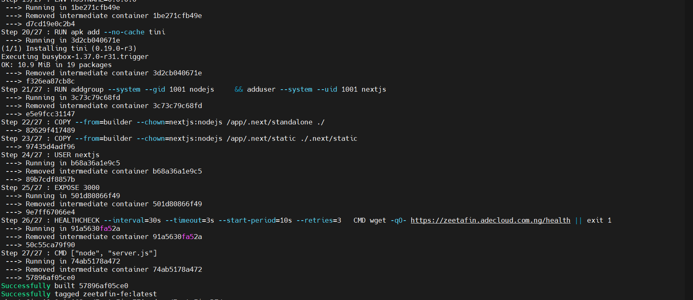
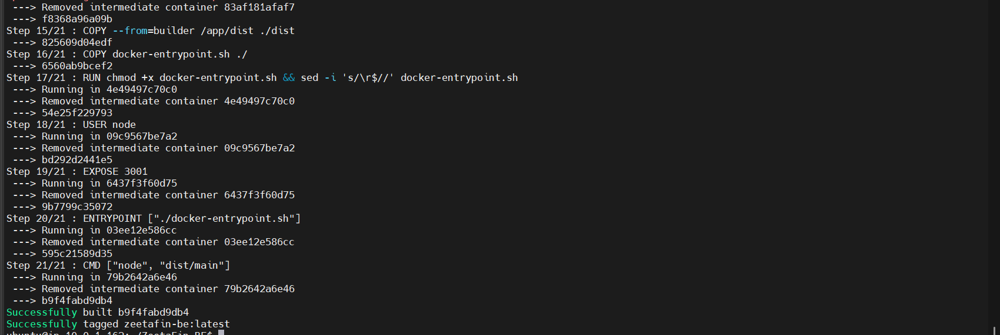
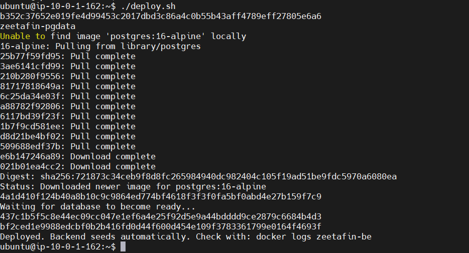
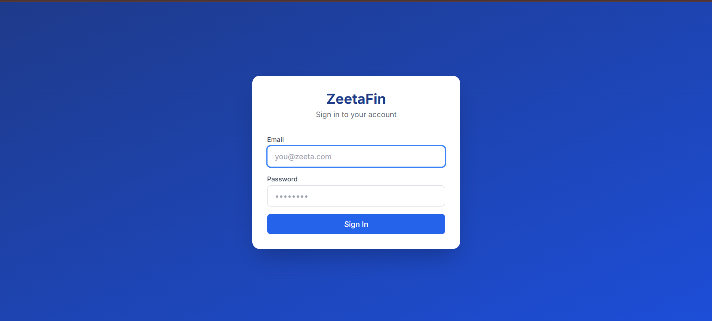
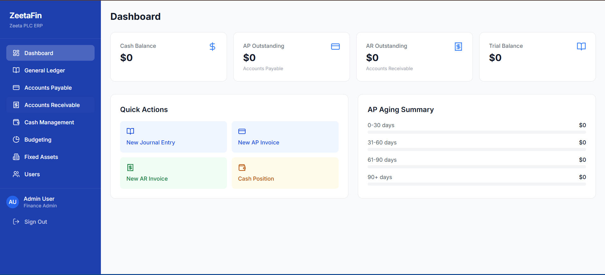
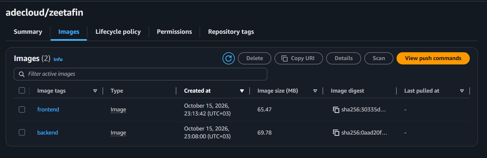
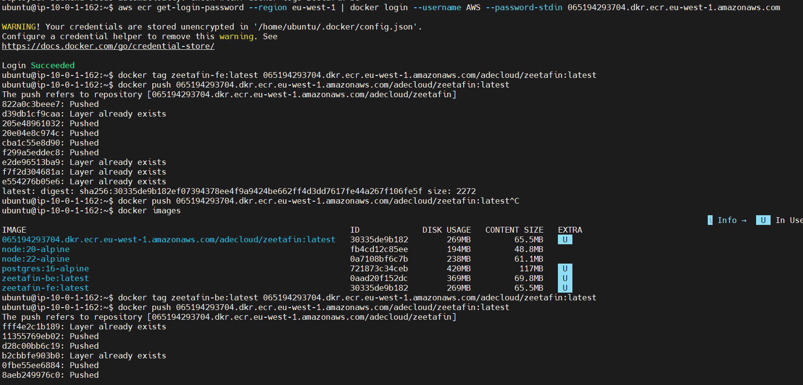

# Phase 2 - Application Containerization and Amazon ECR

## Project Overview

This phase containerizes the ZeetaFin application with Docker, tests it locally, and stores the Docker images in Amazon Elastic Container Registry (ECR).

The application is a two-tier web application:

- **ZeetaFin-BE** - NestJS backend API (Node.js 20, port 3001)
- **ZeetaFin-FE** - Next.js frontend (Node.js 22, port 3000)
- **PostgreSQL 16** - database used by the backend

Terraform is used to create the Amazon ECR repository that stores the images, and an EC2 instance that can later run them.

The workflow demonstrated in this phase:

```text
Application Code
      |
      v
  Dockerfile
      |
      v
  Docker Build
      |
      v
  Docker Image
      |
      v
  Run Container Locally
      |
      v
  Test Application
      |
      v
  Amazon ECR
      |
      v
  Push Docker Image
```

## What This Phase Is Used For

- Package the backend and frontend into portable Docker images
- Run the full application stack (database, backend, frontend) locally with one script
- Verify the application works inside containers before touching AWS
- Create a secure, immutable Amazon ECR repository to hold the images
- Push the built images to ECR so they can be pulled by any AWS host
- Provide the artifacts needed by Phase 3 (GitHub Actions CI/CD)

## Architecture

```text
                       Local / EC2 Host
              +-------------------------------+
              |          deploy.sh            |
              |                               |
              |  +---------+  +-----------+   |      +-----------+
              |  | Postgres|  | Backend   |<--|------|  Amazon   |
              |  | :5432   |  | :3001     |   |      |   ECR     |
              |  +----+----+  +-----+-----+   |      | (images)  |
              |       |             |         |      +-----+-----+
              |       +------+------+         |            ^
              |              |                |            | docker push / pull
              |       +------+------+         |            |
              |       | Frontend    |         |      +-----+-----+
              |       | :3000       |         |      |   EC2     |
              |       +------+------+         |      | (Terraform)|
              |              |                |      +-----------+
              +--------------+----------------+
                             |
                        Web Browser
```

## Project Structure

```text
phase2_docker/
├── Application/
│   ├── ZeetaFin-BE/            # NestJS backend
│   │   ├── Dockerfile          # Multi-stage backend image
│   │   ├── docker-entrypoint.sh# Runs DB seed before start
│   │   ├── .dockerignore
│   │   └── src/
│   ├── ZeetaFin-FE/            # Next.js frontend
│   │   ├── Dockerfile          # Multi-stage frontend image
│   │   ├── .dockerignore
│   │   └── app/
│   ├── deploy.sh               # Starts DB + BE + FE containers
│   └── .env                    # Secrets/config (git-ignored)
│
├── ecr/                        # Terraform: ECR repository
│   ├── main.tf
│   ├── variables.tf
│   ├── outputs.tf
│   └── version.tf
│
├── ec2/                        # Terraform: VPC + EC2 instance
│   ├── main.tf
│   ├── variable.tf
│   ├── outputs.tf
│   └── version.tf
│
├── evidence/                   # Screenshots proving the phase works
│   └── Screenshot_1..7.png
│
└── README.md
```

## Technologies Used

- Docker (multi-stage builds)
- Amazon ECR
- Terraform
- AWS EC2 / VPC / Security Groups
- Node.js 20 and 22 (Alpine images)
- NestJS, Next.js, PostgreSQL 16

## Prerequisites

- Docker
- Terraform
- AWS CLI
- An AWS account with configured credentials
- An EC2 key pair (for the `ec2/` configuration)

Verify the tools:

```bash
docker --version
terraform --version
aws --version
```

Configure AWS credentials:

```bash
aws configure
```

Never commit access keys, secret keys, or `.pem` files to GitHub.

## 1. Build the Docker Images

From `Application/ZeetaFin-BE`:

```bash
docker build -t zeetafin-be:latest .
```

From `Application/ZeetaFin-FE`:

```bash
docker build -t zeetafin-fe:latest .
```

Both Dockerfiles use multi-stage builds:

- **deps** stage installs dependencies with `npm ci`
- **builder** stage compiles the application
- **runner** stage contains only production files and runs as a non-root user

The backend entrypoint (`docker-entrypoint.sh`) runs the database seed with retries before starting the API.

## 2. Run the Application Locally

Copy and edit the environment file:

```bash
cd Application
cp .env.example .env
```

Set at least:

```text
POSTGRES_PASSWORD=<strong-password>
JWT_SECRET=<long-random-secret>
```

Then deploy the full stack:

```bash
./deploy.sh
```

The script:

1. Creates the Docker network `zeetafin-net`
2. Creates the volume `zeetafin-pgdata`
3. Starts PostgreSQL and waits until it is ready
4. Starts the backend on `127.0.0.1:3001`
5. Starts the frontend on `127.0.0.1:3000`

Check the containers:

```bash
docker ps
docker logs zeetafin-be
```

Open:

```text
http://localhost:3000
```

## 3. Create the Amazon ECR Repository

The `ecr/` Terraform configuration creates:

- An ECR repository (`adecloud/zeetafin`)
- Immutable image tags
- Scan-on-push vulnerability scanning
- AES256 encryption
- A lifecycle policy (untagged images expire after 7 days, only the last 30 tagged images are kept)
- A repository policy that restricts access to the AWS account

```bash
terraform -chdir=ecr init
terraform -chdir=ecr validate
terraform -chdir=ecr plan
terraform -chdir=ecr apply
```

Get the repository URL:

```bash
terraform -chdir=ecr output repository_url
```

## 4. Push the Images to ECR

Authenticate Docker with ECR:

```bash
aws ecr get-login-password --region eu-west-1 \
  | docker login --username AWS --password-stdin <ACCOUNT_ID>.dkr.ecr.eu-west-1.amazonaws.com
```

Tag and push:

```bash
docker tag zeetafin-be:latest <ACCOUNT_ID>.dkr.ecr.eu-west-1.amazonaws.com/adecloud/zeetafin:be-latest
docker tag zeetafin-fe:latest <ACCOUNT_ID>.dkr.ecr.eu-west-1.amazonaws.com/adecloud/zeetafin:fe-latest

docker push <ACCOUNT_ID>.dkr.ecr.eu-west-1.amazonaws.com/adecloud/zeetafin:be-latest
docker push <ACCOUNT_ID>.dkr.ecr.eu-west-1.amazonaws.com/adecloud/zeetafin:fe-latest
```

Verify the images exist in the ECR console.

## 5. EC2 Instance (Optional / Phase 3 Preview)

The `ec2/` Terraform configuration creates:

- VPC, public subnet, internet gateway, route table
- Security group allowing SSH (22), HTTP (80), HTTPS (443)
- Ubuntu 24.04 EC2 instance

```bash
terraform -chdir=ec2 init
terraform -chdir=ec2 plan
terraform -chdir=ec2 apply
```

Get the public IP:

```bash
terraform -chdir=ec2 output project_instance_public_ip
```

This instance is where the images pulled from ECR will be deployed in Phase 3.

## Security Group

| Protocol | Port | Purpose |
|----------|------|---------|
| TCP | 22 | SSH |
| TCP | 80 | HTTP |
| TCP | 443 | HTTPS |

## Evidence

Screenshots proving the phase completed successfully are stored in `evidence/`:









## Cleanup

Stop the local containers:

```bash
docker rm -f zeetafin-db zeetafin-be zeetafin-fe
```

Remove the AWS resources to avoid charges:

```bash
terraform -chdir=ec2 destroy
terraform -chdir=ecr destroy
```

Type `yes` when prompted.

## Security Notes

The following must never be committed to GitHub:

- `.env` files (git-ignored)
- AWS access keys and secret keys
- SSH private keys (`.pem`, `.key`)
- Passwords and JWT secrets
- Terraform state files (git-ignored)

## Conclusion

This phase demonstrates:

- **Docker** packages the backend and frontend into portable images
- **Multi-stage builds** keep the final images small and production-ready
- **deploy.sh** runs the complete application stack with a single command
- **Terraform** creates the ECR repository and EC2 infrastructure as code
- **Amazon ECR** stores the images securely for deployment

The result is a containerized application stored in Amazon ECR, ready for the Phase 3 GitHub Actions pipeline.
